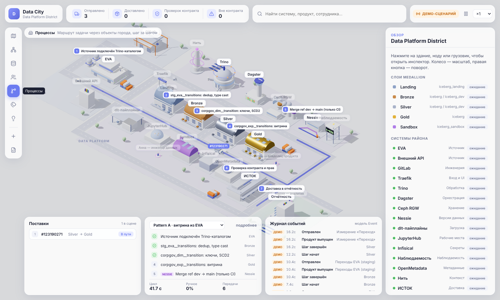

# Data City — интерактивный цифровой город предприятия

**Архитектура, которую можно исследовать. Процессы, которые можно увидеть. Изменения, эффект которых можно измерить.**

Data City показывает архитектуру предприятия как живой индустриальный город. Бизнес-домены — районы,
информационные системы — здания, продукты данных — грузы, интеграции и бизнес-процессы — маршруты.
Сотрудники — персональные ноды с контекстом и цифровыми помощниками.

Этот репозиторий — **Data Platform District**: детально проработанный район, построенный по реальной
архитектуре платформы данных — слои Medallion, два паттерна загрузки, три потока изменений и стандарт
именования.



## Быстрый старт

```bash
npm install
npm run dev            # http://localhost:5173
```

| Команда | Что делает |
| --- | --- |
| `npm run dev` | dev-сервер Vite |
| `npm run build` | проверка типов + production-сборка в `dist/` |
| `npm test` | unit-тесты модели, маршрутизации, симуляции и анализа (Vitest) |
| `npm run validate:model` | проверка `enterprise.json` и `space.json`: схема, ссылки, размещения, порты |
| `npm run export:schema` | генерация JSON Schema из Zod-схем в `schemas/` |
| `npm run export:mermaid` | Mermaid-диаграммы из той же модели (см. [`docs/model.md`](docs/model.md)) |
| `npm run mock:live` | тестовый источник фактических событий (SSE) на `:8787` |

Режим фактических событий: `npm run mock:live`, затем откройте
`http://localhost:5173/?live=http://localhost:8787/events` и переключите бейдж «ДЕМО-СЦЕНАРИЙ» → «ФАКТ».

## Что есть сейчас

**Район Data Platform.** Производственная линия слоёв вдоль главной дороги — цеха **Landing · Bronze · Silver ·
Gold** (у каждого свой цвет, Silver и Gold — металлические) и **Sandbox** рядом с JupyterHub. Сервисы платформы —
отдельные здания со своим смыслом: **Trino** — круглый узел запросов с кольцом федеративных каталогов,
**Dagster** — диспетчерская вышка с табло ассетов, **Ceph RGW** — силосы по бакету на слой, **Nessie** —
стрелочный пост, где вагон уходит в ветку `dev` и возвращается merge в `main`, **dlt** — приёмный док,
**Traefik** — ворота для людей и UI, **Infisical** — хранилище секретов, **наблюдаемость** — вышка с экраном.
Рядом — источники (EVA, внешний API), GitLab, OpenMetadata, Нить, ИСТОК и отчётность.

**Слой — сущность модели.** У каждого слоя: Trino-каталог, Nessie ref, бакет, префиксы, репозиторий, что
на слое делаем и чего не делаем. Продукты данных привязаны к слою, имеют техническое имя (`stg_eva__transitions`,
`corpgov_dim__transition`, `corpgov_exp__transitions`) и lineage.

**Три процесса** (выбор в панели процесса):
- **Pattern A · витрина из EVA** — источник читается на месте через Trino: по первому участку едет не грузовик,
  а светящийся импульс (данные не копируются, Landing пропускается). Дальше Bronze → Silver → Gold, merge
  `dev → main` в Nessie (только CI), проверка контракта в ИСТОК, доставка в отчётность. Цвет контейнера
  меняется по слою.
- **Pattern B · загрузка через dlt** — внешний API → dlt → Landing (копия, по расписанию) → Bronze → Silver.
- **Изменение модели: Git → Nessie → релиз** — MR, ревью, CI, пересборка в своей ref и merge, тег образа и
  release manifest, выкладка в Dagster, сообщение в `dp-changelog`.

**Проверки стандартов — исполняемые.** Префикс слоя (`stg_` / `_dim__ _fct__ _br__` / `_pdim__ _pfct__ _exp__`),
коды источника и домена из реестра, запрет кириллицы в технических именах, Landing только для Pattern B,
Bronze 1:1 к источнику. Проверка работает в инспекторе продукта, в редакторе (подсказка при вводе имени) и в
режиме «Улучшения». Для процессов изменения проверяется, что пройдены все три флоу.

**Движение.** Любой грузовик можно выбрать: груз, версия, владелец, источник, контракт, разрешённый маршрут с
отметкой пройденных точек, текущая фаза. Во время шага подсвечиваются и участники «через» — Dagster и Trino.

**Семь представлений одной модели** (левая панель): Город · Системы (коннекторы и интерфейсы) · Данные
(потоки и продукты) · Люди и ноды (связи через Нить) · Процессы (маршрут и шаги) · Метаданные (владельцы,
интерфейсы, контракты, разрешённые маршруты) · Улучшения (узкие места и предложения). Здания остаются на
месте — меняется линза.

**Инспектор.** Для любой сущности: назначение и владелец, домен, технологии и интерфейсы, контракты и
зависимости, события и состояние, документация, история изменений. Все ссылки кликабельны и переносят камеру.

**Редактор.** Добавление системы, сотрудника, связи и продукта данных (с черновиком контракта). Новое здание
автоматически размещается на свободном участке района, разворачивается к ближайшей дороге и подключается к
дорожной сети собственным портом. Изменения сохраняются локально; модель экспортируется в JSON и Mermaid,
импортируется обратно с валидацией.

**Улучшения: наблюдаем → понимаем → улучшаем → измеряем.** Ручной шаг становится кандидатом на
автоматизацию, только если в модели описана конкретная идея (`automation`). Ревью MR остаётся за человеком,
а сообщение в `dp-changelog` предлагается публиковать из release manifest — вариант «как будет» сравнивается
численно и проигрывается в городе. Длительности в демо условные.

**Публичный репозиторий — без инфраструктурных секретов.** В модели только контур (`prod`/`test`) и логическая
группа хостов. Имена ВМ, адреса, DNS и ссылки на внутренний GitLab в репозиторий не попадают — они остаются в
приватном инвентаре.

**Честность визуализации.** Каждое событие несёт `source: "demo" | "live"`. Демо-сценарий всегда помечен,
инспектор грузовика прямо говорит, что анимация иллюстративна; фоновый транспорт объявлен декоративным.
Фактические события из источника валидируются по схеме, некорректные отбрасываются, а не анимируются.

## Архитектура в двух абзацах

**Модель важнее визуализации.** Источник истины — модель предприятия
([`src/model/schema.ts`](src/model/schema.ts)): `Domain · System · DataLayer · EmployeeNode · DataProduct ·
Contract · Connector · Process · Event · Relationship` с устойчивыми идентификаторами вида `sys.data-platform`. Отдельно
от неё — пространственная модель ([`src/space/schema.ts`](src/space/schema.ts)): районы, дороги, размещение
сущностей, архетипы зданий, порты. 3D-сцена, Mermaid, инспектор и анализ — проекции этих двух моделей.

**Симуляция — чистая функция.** [`src/sim/engine.ts`](src/sim/engine.ts) компилирует процесс в прогон
(фазы работы, пути, ожидание человека) и поток событий; рендер лишь сэмплирует прогон во времени. Поэтому
сценарии тестируются без браузера, «как есть» и «как будет» сравниваются численно, а фактические события
проигрываются тем же механизмом.

Подробнее: [`docs/ARCHITECTURE.md`](docs/ARCHITECTURE.md) · решения по стеку:
[`docs/adr/0001-stack.md`](docs/adr/0001-stack.md).

```
src/
  model/      модель предприятия: Zod-схемы, индекс и проверка ссылок, стандарт именования, Mermaid
  space/      пространственная модель: схемы, маршрутизация по дорогам, авторазмещение
  sim/        движок симуляции, анализ процессов (улучшения), часы
  adapters/   источники событий (live: SSE с валидацией)
  assets/     каталог архетипов → 3D-компоненты (слот для GLB из Blender)
  scene/      React Three Fiber: здания, дороги, транспорт, линзы и оверлеи
  ui/         панели, инспектор, редактор, экспорт
  store/      состояние приложения (Zustand)
  data/       демо-модель района: enterprise.json + space.json
schemas/      JSON Schema, сгенерированные из Zod (автодополнение в редакторе)
scripts/      validate-model, export-schema, export-mermaid, mock-live
```

## Дальше

См. раздел «Дорожная карта» в [`docs/ARCHITECTURE.md`](docs/ARCHITECTURE.md): ассеты из Blender, адаптеры
OpenMetadata и Нить, реконструкция фактических процессов, сравнение состояний по реальным событиям.
