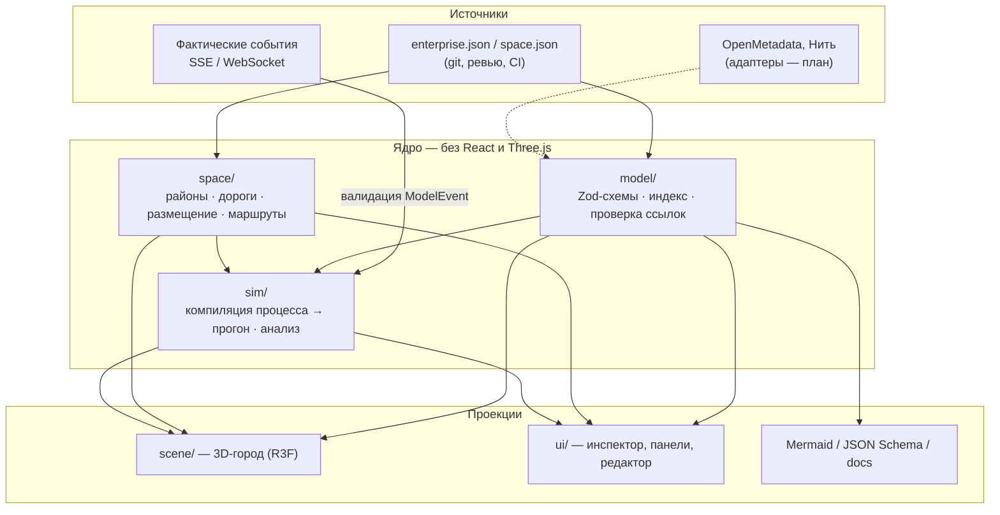

# Архитектура Data City

## Слои

Правило зависимостей: `model` ни от чего не зависит; `space` знает только идентификаторы сущностей;
`sim` зависит от `model` и `space`; `scene`/`ui` — потребители. Ядро целиком покрыто unit-тестами и
выполняется в Node (скрипты валидации и экспорта используют те же модули).

## Модель предприятия

| Сущность | Ключевые поля | В городе |
| --- | --- | --- |
| `Domain` | `character` | район |
| `System` | `domainId`, `role`, `technologies`, `interfaces`, `contour`, `hostGroup`, `repos`, `sourceCode`, `loadPattern` | здание; архетип по роли |
| `EmployeeNode` | `role`, `skills`, `assistant`, `context` | нода с помощником |
| `DataLayer` | `layer`, `catalog`, `nessieRef`, `bucket`, `prefixes`, `repo`, `does/doesNot` | цех слоя Medallion |
| `DataProduct` | `producedBy`, `layerId`, `technicalName`, `version`, `sources`, `quality` | груз; цвет контейнера — по слою |
| `Contract` | `productId`, `providerId`, `consumerId`, `interface`, `sla`, `allowedRoute` | разрешённый маршрут, проверка в ИСТОК |
| `Connector` | `fromId`, `toId`, `interface`, `technology` | связь (режим «Системы»/«Данные») |
| `Process` | `category`, `steps[]: actorId, via, carries, transport (truck/pipe), flow, manual, automation` | маршрут задачи |
| `Event` | `type`, `subjectId`, `source: demo \| live` | движение, статусы, журнал |
| `Relationship` | `type`, `fromId`, `toId` | связи людей, владение, «описывает» |

Идентификаторы — `kind.slug` (`sys.istok`, `dp.subscriber-base`). Они стабильны: визуальное представление,
положение, архетип можно менять, не трогая ссылки и историю.

## Стандарты платформы как код

`src/model/naming.ts` превращает соглашения в проверки: префикс слоя, коды источника и домена из реестра (модели),
запрет кириллицы, Landing только для Pattern B, Bronze 1:1. `processChecks` для процессов категории `change`
проверяет прохождение Git Flow, Nessie Flow и релизного цикла. Результаты видны в инспекторе, редакторе и
режиме «Улучшения»; при переносе модели в CI те же функции смогут блокировать MR.

Инфраструктурные детали (имена ВМ, адреса, DNS) в модель не входят: у системы есть только `contour` и
логическая `hostGroup`. Репозиторий публичный — конкретика остаётся в приватном инвентаре.

## Пространственная модель

`space.json` описывает районы (прямоугольники доменов), дорожный граф (узлы + рёбра), размещения
(`entityId`, `archetype`, `position`, `rotation` в четвертях оборота, `footprint`, `port` — узел дороги для
погрузки) и декоративные объекты. Маршруты ищутся Дейкстрой по графу. `autoPlace` подбирает свободный участок
в районе, разворачивает погрузочную зону к ближайшей дороге и врезает в ребро новый узел-порт.

## Симуляция и события

`compileProcess(process)` → `Run { phases[], events[] }`:

- `work` — шаг выполняется на объекте;
- `travel` — перемещение между портами по кратчайшему пути (с флагом `routeViolation`, если объект не входит
  в `allowedRoute` контракта);
- `manual` — ручной шаг: транспорт стоит, нода сотрудника подсвечена.

События (`step.started/completed`, `product.produced`, `product.dispatched`, `contract.checked`,
`product.delivered`) генерируются тем же проходом. `sampleRun(run, t)` даёт позу транспорта и текущую фазу —
рендер читает её в кадре, не задевая React. Фактические события (`product.dispatched` с `fromId/toId`,
`system.status`) превращаются в те же прогоны через `compileTrip`.

`analysis.ts` считает метрики (цикл, работа, путь, ручное время, передачи), находит проблемы и сравнивает
процесс с предложением (`Proposal.apply(process) → process'`). Предложение — тоже модель, поэтому его можно
проиграть в городе.

## Представления (линзы)

Одна сцена, семь функций `lensFor(view, entity)` → `normal | dim | focus` плюс оверлеи и подписи из
`LabelExtra`. Новое представление = новая линза, без новой карты.

## Ассеты

`assets/catalog.ts` сопоставляет архетип с компонентом. Сейчас все архетипы процедурные (лёгкие, без
загрузки, легко перекрашиваются линзами). Для модели из Blender: экспорт GLB в `public/assets/`, поле `glb`
в каталоге — `Building` загрузит его через `useGLTF`, сохранив трансформацию, порт и взаимодействие.
Рекомендуемый конвейер: Blender → glTF → `gltf-transform` (meshopt + KTX2) → единая палитра-текстура.

## Дорожная карта

1. **Ассеты.** Заменить процедурные архетипы моделями Blender для 3–4 ключевых объектов; инстансинг для
   повторяющихся (деревья, контейнеры, грузовики).
2. **Модель как код.** Хранить модель в git, `validate:model` в CI, генерация `docs/model.md` при сборке.
3. **Адаптеры источников.** OpenMetadata → `System/DataProduct/Relationship`; ИСТОК → контракты и доставки;
   Нить → ноды, контекст, события взаимодействий.
4. **Реконструкция процессов.** Из цифрового следа Нить строить `Process` с фактическими длительностями;
   сравнивать «как есть» (факт) и «как будет» (предложение) на одной сцене.
5. **Масштаб.** Уровни детализации: город → район → здание (интерьер с рабочими станциями);
   разделение на npm-workspaces (`model`, `space`, `sim`, `scene`, `app`), когда появится второй потребитель
   ядра (например, сервер или CLI).
