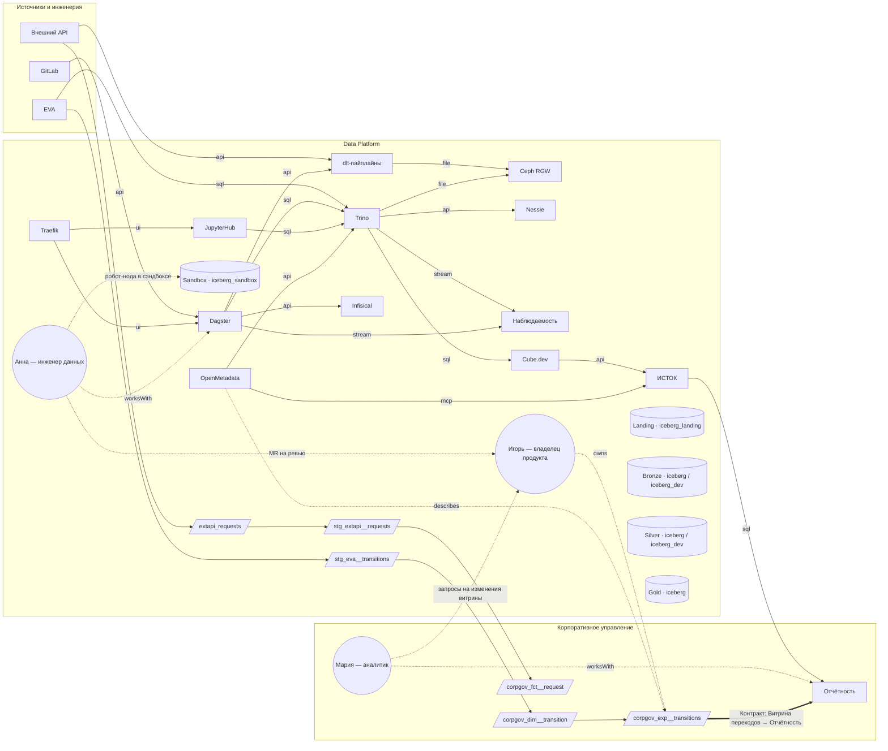
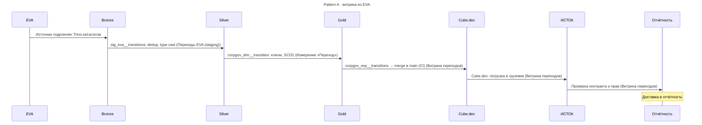
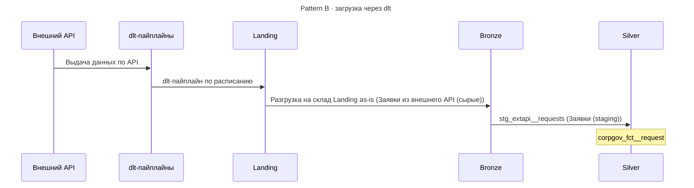
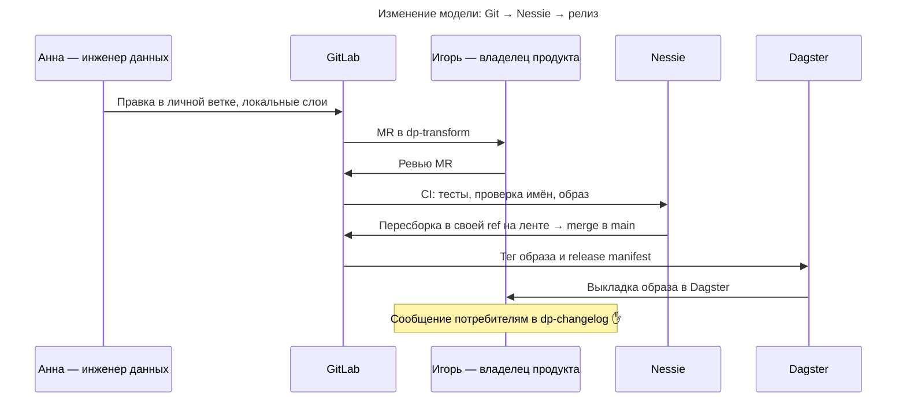

# Модель предприятия — Mermaid

> Сгенерировано из `src/data/enterprise.json` командой `npm run export:mermaid`. Не редактировать вручную.

## Связи систем

## Процесс: Pattern A · витрина из EVA

## Процесс: Pattern B · загрузка через dlt

## Процесс: Изменение модели: Git → Nessie → релиз

