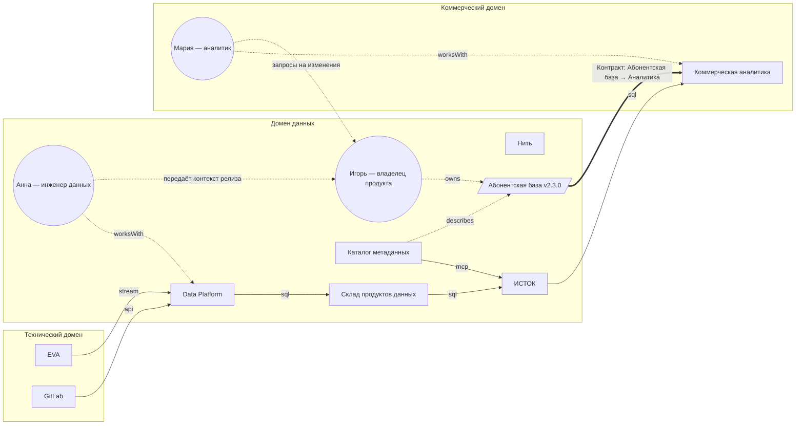
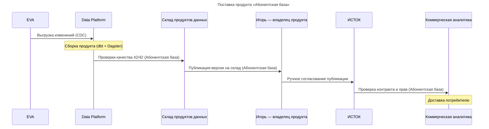

# Модель предприятия — Mermaid

> Сгенерировано из `src/data/enterprise.json` командой `npm run export:mermaid`. Не редактировать вручную.

## Связи систем

## Процесс: Поставка продукта «Абонентская база»

